# Hands-On Guide: AI Document Processing in Pega Platform '26

*A practical lab for building document extraction, confidence-based routing and conversational document analysis with Pega GenAI. November 2026.*

## 1. About this guide

This guide walks a system architect through building AI-driven document processing in Pega Platform '26, end to end, using a financial services scenario. Instead of describing features in the abstract, each module produces a working piece of the application: a data model, a DocAI Connect Rule, a Case Lifecycle step, confidence-based routing.

Pega's documentation describes the goal plainly: Pega GenAI analyzes and extracts data from documents so that you increase automation in your processes, minimizes the need for user input, and decreases the risk of erroneous data. The practical payoff is that case workers start from pre-filled, validated data and spend their time on decisions that need human judgment.

### What you will build

The lab application is a simplified **Loan Application** for a retail lender. An applicant uploads a pay stub; Pega GenAI reads it, populates income details on the Case, scores its own confidence in each value, and either continues straight through or routes the Case to an underwriter for review.

### Two ways Pega '26 processes documents

| **Approach** | **Where it runs** | **Best for** | **Configuration effort** |
|----|----|----|----|
| DocAI Connect Rule | As an automation step inside the Case Lifecycle | Repeatable extraction of specific fields the Case needs (income, identity, invoice data) | You define the Rule, prompt, attachment field, response mode and mapping |

For each business process, you choose the approach that suits it and how much of the work can run without manual review.

## 2. Prerequisites and environment setup

Complete this checklist before starting Module 1. Most failed lab runs trace back to one of these items.

| **Item** | **Requirement** | **Why it matters** |
|----|----|----|
| Platform version | Pega Platform '26 | Menu paths and Rule forms in this guide follow the '26 documentation |
| Hosting | Pega Cloud recommended | Only Pega Cloud supports OCR preprocessing and confidence scores; on-premises deployments are limited to basic extraction |
| Pega GenAI | GenAI enabled for the environment, with access to the Pega GenAI Gateway | DocAI Connect and Agents call LLMs through the gateway |
| Release toggle | EnableDocumentAgent turned on | Required to use DocAI Connect Rules in your application |
| UI architecture | Constellation application | Required for the Agent exercises |
| Access | Developer access to Pega Infinity Studio for the application | You create Rules, data objects and Case Type changes |
| Test documents | Synthetic pay stubs and bank statements (PDF and image scans) | Never use real customer documents in a lab environment |

> **Note on labels.** Pega's '26 documentation has used both "GenAI Connect with the Enable Document Agent option" and "DocAI Connect Rule" for this capability across updates. If your build shows one label rather than the other, follow the equivalent option; the configuration fields are the same.

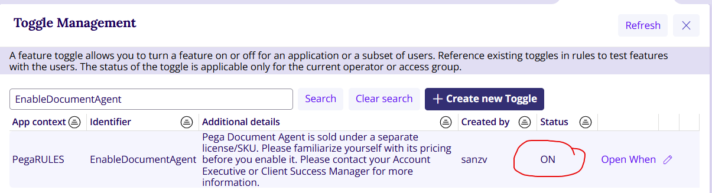

### Prepare the test documents

Create a small, deliberate test set so you can see each behavior of the Rule:

1.  A clean, digitally generated pay stub PDF (expect high confidence on all fields).*\[ex:pay-stub-jordan-lee-2026-10-15.pdf\]*

2.  A scanned, slightly skewed photo of the same pay stub (tests OCR quality).*\[ex: pay-stub-jordan-lee-skewed.png\]*

3.  A pay stub with a missing or smudged field, such as an unreadable year-to-date figure (should trigger manual review)*.\[ex: pay-stub-jordan-lee-smudged-name.png\]*

4.  A document that is not a pay stub at all, such as a utility bill (tests how the Rule handles the wrong document type).*\[ex:utility-bill-jordan-lee-2026-10.pdf\]*

## 3. Module 1: Model the data

DocAI Connect maps extracted values into fields of your Case Data Model, so the data model comes first. Pega's own resume-processing tutorial follows the same order: add a single-record attachment field to the Case Type, define a data object with the target fields, and embed it in the Case.

### Steps

1.  In Infinity Studio, create (or open) a Case Type named **Loan Application** with a Create stage, an Income Verification stage, an Underwriting stage and a Resolution stage.

2.  In the Loan Application data model, add an attachment field named **Income Document**, configured as a **single record** attachment field.

3.  Create a data object named **Applicant Income** with the fields in the table below.

4.  Add Applicant Income to Loan Application as an **embedded data** field.

5.  Add a View in the Create stage that lets the applicant upload the Income Document.

| **Field** | **Type** | **Example value** | **Notes** |
|----|----|----|----|
| Employee Name | Text | Jordan Lee | Compare later against the applicant name on the Case |
| Employer Name | Text | Northwind Logistics Inc. |  |
| Pay Period Start | Date | 2026-10-01 |  |
| Pay Period End | Date | 2026-10-15 |  |
| Pay Frequency | Picklist | Bi-weekly | Weekly, Bi-weekly, Semi-monthly, Monthly |
| Gross Pay | Currency | 3,250.00 | Per pay period |
| Net Pay | Currency | 2,418.60 |  |
| Year-to-Date Gross | Currency | 61,750.00 | Used for annualized income checks |
| Document Type | Text | Pay stub | Lets you detect wrong-document uploads |

**Checkpoint:** Run a Case to the Create stage and confirm you can upload a file to Income Document and that the Applicant Income fields appear (empty) on the review View.

## 4. Module 2: Create the DocAI Connect Rule

### Steps

1.  In the header of Pega Infinity Studio, click **Create \> Generative AI**, then choose the **DocAI Connect** option (in some '26 builds this is **GenAI Connect** with the **Enable Document Agent to extract information from documents** check box selected).

2.  In the **Label** field, enter **Extract Pay Stub Income**.

3.  In the **Apply to** list, select your Loan Application class (for example, the Work- class of your Loan Application Case Type).

4.  Click **Create and open**. Pega opens a tab for the unsaved Rule.

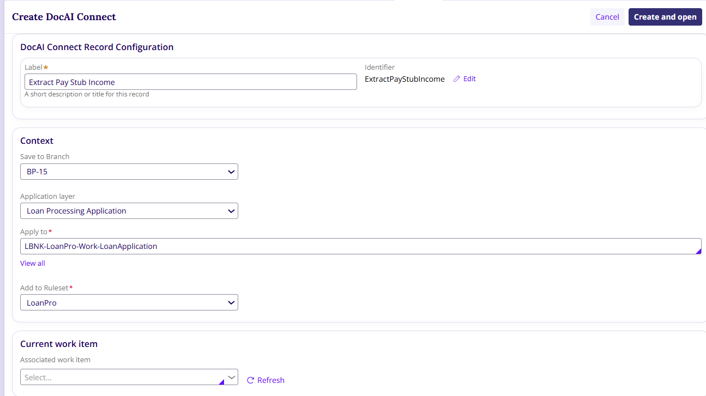

### Write the prompt

1.  In the **User prompt** field, click the **Target** icon to create a new reusable prompt.

2.  On the Create Field Value tab, enter the label **Extract Pay Stub Income** and click **Create and open**.

3.  In the **To** field, describe the job in plain language. **A good starting point:**

*<u>**Starting Prompt:**</u> This Rule is a payroll document extraction assistant for a retail lender. Its goal is to accurately extract income information from an applicant's pay stub: employee name, employer name, pay period start and end dates, pay frequency, gross pay, net pay and year-to-date gross pay. Return amounts as numbers without currency symbols and dates in ISO format. If a value is not present or cannot be read, leave it empty rather than guessing. Identify the document type, and state "Not a pay stub" if the document is something else.*

***\[refer to more fine-tuned prompt at assets section at the end\]***

4.  Click **Save**. Based on your description, Pega AI Assistant generates the system prompt that the Rule uses.

### Configure the Rule

1.  On the Rule tab, review the generated **System prompt** and **User prompt** and adjust them if needed.

2.  In the **Select attachment field** list, select **Income Document**.

3.  In the **Expected response mode** list, select **Structured - Single**, because one pay stub produces one set of income fields.

4.  Map the response to the Applicant Income embedded data fields you created in Module 1.

5.  If you are on Pega Cloud, turn on **OCR preprocessing and confidence scores** for the Rule.

6.  Click **Save**.

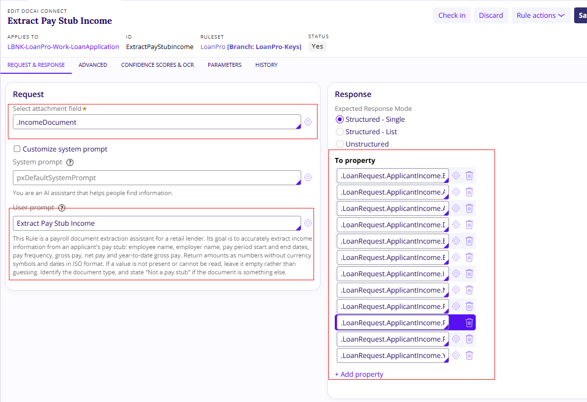

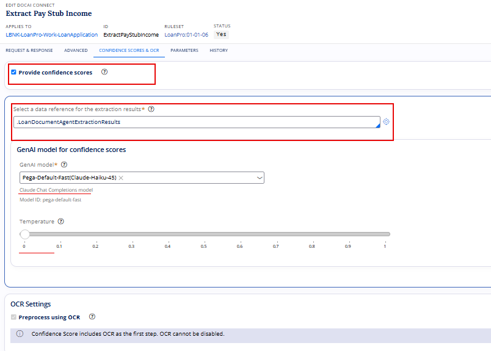

### Prompt design tips that pay off

*Pega's best-practice guidance for these Rules recommends separating instructions from examples, keeping each prompt focused on a single objective, and avoiding hard-coded values that change at run time. Use Pega properties to make prompts dynamic instead. For example, you can include {.ApplicantName} in the prompt so that the model knows whose pay stub it should expect. This could be part of a process where the user initiates/or the profile pre-loaded.*

## 5. Module 3: Add the step to the Case Lifecycle

1.  Open the Loan Application Case Type and go to the **Income Verification** stage.

2.  Add a **DocAI Connect** automation step as the first step of the stage.

3.  In the step properties, select the **Extract Pay Stub Income** Rule.

4.  After the automation step, add a **Review income details** assignment that shows the Applicant Income fields as editable, for use when manual review is needed (Module 4).

5.  Save the Case Type.

**Checkpoint:** Create a Case, upload the **clean pay** stub (ex: *pay-stub-jordan-lee-2026-10-15.pdf*) and advance to Income Verification. The Applicant Income fields should be populated without anyone typing them.

**Pay Stub:**

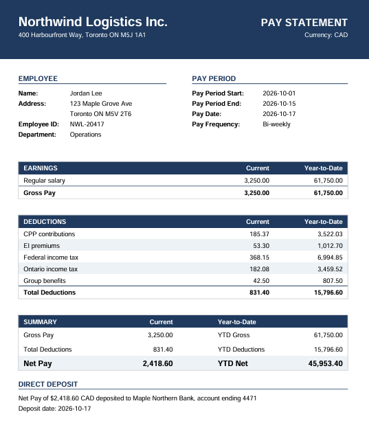

**Test Results:** processed from Doc AI

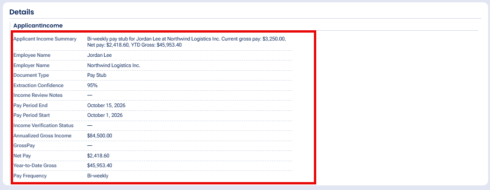

## 6. Module 4: Confidence-based routing

This is where document processing turns from a convenience into real straight-through processing. On Pega Cloud with OCR enabled, a DocAI Connect Rule processes each document in four steps:

| **Step** | **What happens** |
|----|----|
| 1\. Upload | A user uploads a document to a Case or in a conversation with an Agent |
| 2\. OCR | Amazon Textract OCR, run by the Smart Chunking Service, pulls out the document text one line at a time |
| 3\. Extraction | Using the field list, the OCR text and the original document, an extraction LLM produces a value for each field |
| 4\. Assessment | A second (assessment) LLM verifies each value against the source document and assigns a confidence score |

If all extracted fields return high confidence, the Case moves ahead with straight-through processing. If any field comes back with a low score, the Case sends the document to a reviewer.

### Steps

1.  Run a Case with *pay-stub-jordan-lee-2026-10-15.pdf* and open the Tracer or the Clipboard to locate the confidence results the Rule returns for each extracted field. Note the property names in your build.

**The confidence score for each field returned from the clear paystub -** *pay-stub-jordan-lee-2026-10-15.pdf*

**Confidence scores for each field.**

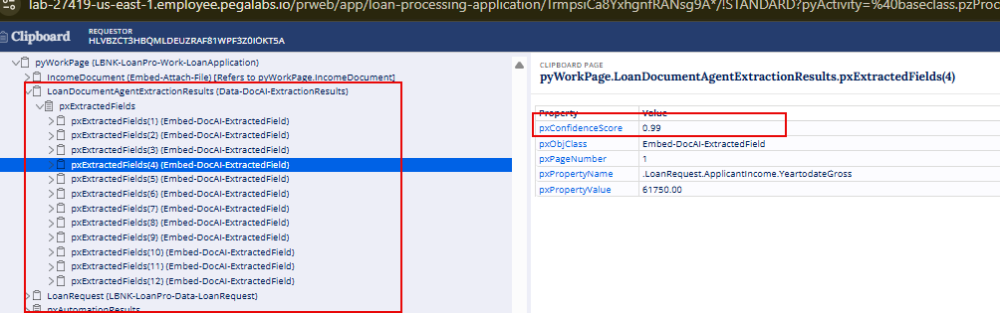

2.  Define a when condition such as **Income extraction needs review**, which is true if any required field (Gross Pay, Pay Period End, Employee Name) has a low confidence result or is empty.

3.  Extend the condition with business checks the model cannot judge on its own: the Employee Name does not match the applicant on the Case, or Document Type is not a pay stub.

4.  Make the **Review income details** assignment conditional on that when rule, and route it to an **Additional Information** assignment.

5.  When the condition is false, the Case skips the assignment and continues straight to **Underwriting**.

Ex: check for confidence score

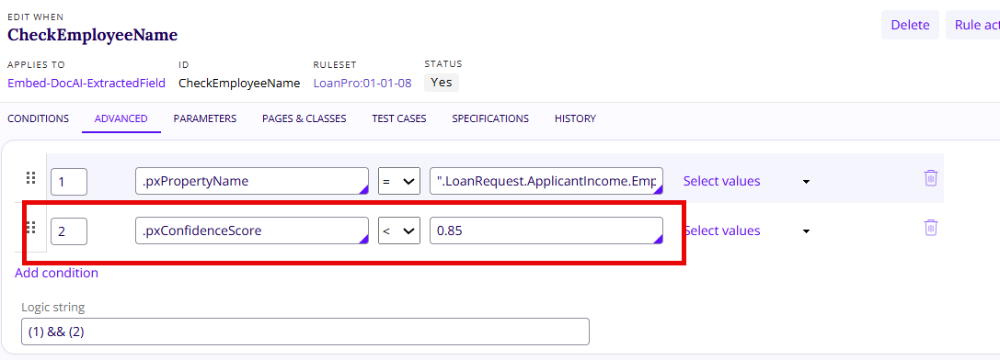

**Checkpoint:** Run test documents 1 to 4. Document 1 should pass straight through. Documents 3 and 4 should land in the Underwriting Review queue. Record how document 2 (the skewed scan) behaves; it tells you how much image quality matters for your client's real intake channel.

> **On-premises clients:** without OCR preprocessing and confidence scores, you get basic extraction only. Design for manual verification of key fields, or add deterministic business-rule validation such as totals, date ranges and name matching, before you allow straight-through processing.

**Checking with document 1** \[ex: *pay-stub-jordan-lee-2026-10-15.pdf\]*

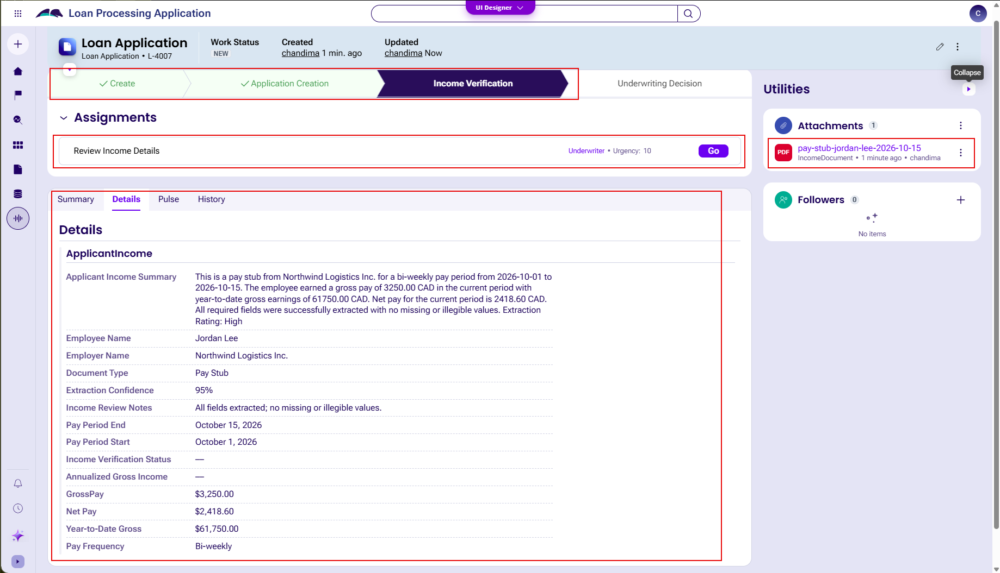

**Checking with Document 2** *\[ex:pay-stub-Jordan-lee-skewed.png\]*

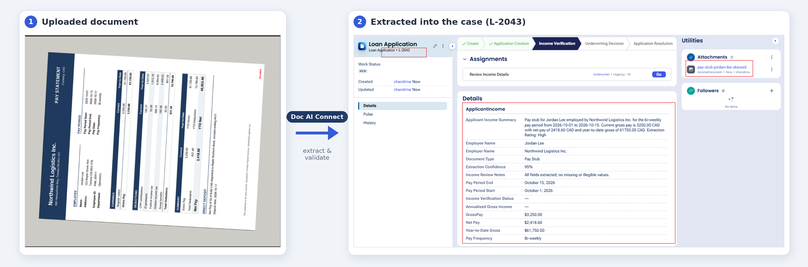

**Checking with document 3***\[ex: pay-stub-jordan-lee-smudged-name.png\]*

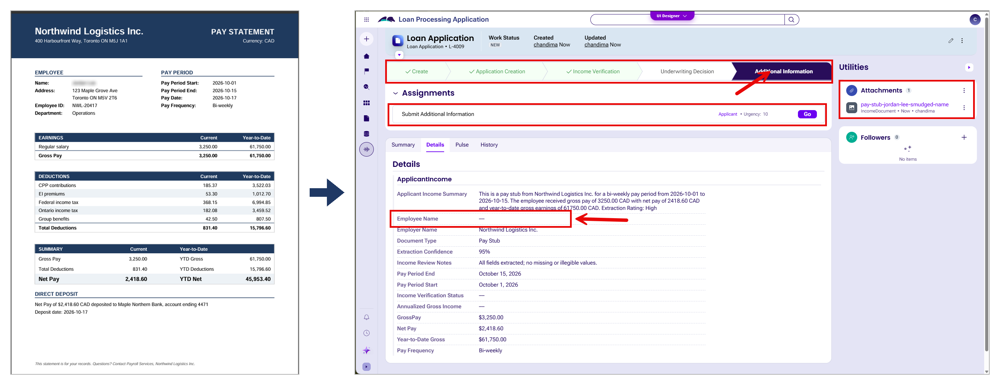

**Checking with document 4** *\[ex:utility-bill-jordan-lee-2026-10.pdf\]*

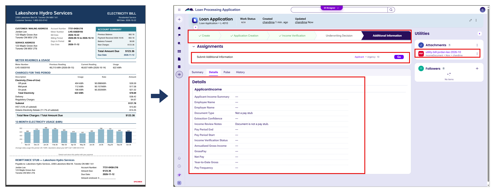

## 7. Module 6: Protect sensitive data

Pay stubs and bank statements carry exactly the kind of data FSI clients scrutinize. Pega's guidance is to avoid including sensitive or restricted data in AI prompts and to use the platform's options to mask or limit the data sent in GenAI requests.

1.  Review the prompt and any properties it references; remove anything the model does not need, such as account numbers or government identifiers.

2.  Configure masking for sensitive data used with AI for fields that must never leave the platform in clear text.

3.  Be aware that the Smart Chunking Service is hosted on Pega Cloud but does not pass through the Pega GenAI Gateway. Confirm that this data flow is covered in your client's data-residency and security review.

4.  Restrict who can see the original attachment and the extracted values with the usual access controls for the Case Type.

## 8. Design guidance for client projects

### Choosing the approach

| **Question** | **If yes** | **If no** |
|----|----|----|
| Is the same document type received on most Cases? | DocAI Connect Rule in the lifecycle | Agent conversation |
| Must specific fields be populated before work can continue? | DocAI Connect Rule | Agent conversation |
| Is the task open-ended analysis or Q&A about a document? | Agent conversation | DocAI Connect Rule |
| Is the client on Pega Cloud? | Plan for confidence-based straight-through processing | Plan for basic extraction plus human verification |

### Reuse and governance

Structure Rules so they can be reused across Case Types rather than creating separate Rules for similar tasks. A single income-extraction Rule, for instance, can serve personal loans, credit card applications and mortgage pre-qualification. Keeping AI interaction separate from core business logic also helps governance, because the AI Rules can be reviewed and updated on their own schedule.

### Use cases to propose

| **Use case** | **Documents** | **Extraction or analysis** |
|----|----|----|
| Loan and mortgage origination | Pay stubs, T4 or W-2 slips, employment letters, bank statements | Income, employer, tenure, deposit patterns |
| KYC and customer onboarding | Government ID, proof of address | Identity fields, address, expiry dates |
| Insurance claims intake | Invoices, medical bills, handwritten accident statements | Claim details pre-filled for the adjuster |
| Commercial lending | Financial statements, tax returns | Revenue, liabilities, key ratios for the analyst |
| Disputes and fraud review | Statements, receipts, expense reports | Flagging anomalies and suspicious transactions |

## 11. Troubleshooting

| **Symptom** | **Likely cause** | **What to check** |
|----|----|----|
| DocAI option not visible when creating a Rule | Release toggle off | Confirm EnableDocumentAgent is turned on for the application |
| No confidence scores returned | On-premises environment or OCR not enabled | Confirm the environment is Pega Cloud and that OCR preprocessing and confidence scores are turned on |
| Fields extracted but not populated on the Case | Mapping mismatch | Response mode (Structured - Single) and field mapping to the embedded data object |
| Agent rejects the attachment | File type or size not supported by the model | The LLM provider's limits for attachment types and sizes |
| Agent cannot accept attachments at all | Traditional UI application | Agent document processing works only in Constellation applications |
| Slow Case progression at the DocAI step | LLM latency or Rule configuration | PAL timing for each processing step |

## 12. Completion checklist

- Applicant Income data object and Income Document attachment field are in place.

- Extract Pay Stub Income Rule is saved with a reviewed system and user prompt.

- DocAI Connect step runs at the start of Income Verification.

- Low-confidence or mismatched extractions route to the Underwriting Review queue.

- Unit tests and fixed-data runs pass; all five test documents are recorded.

- Sensitive data in prompts is minimized and masked.

- The Agent flags the planted transactions on the bank statement.

## 13. Assets

**Updated prompt:**

```text
You are a payroll document extraction assistant for a retail lender. Your goal is to accurately extract income information from an applicant's pay stub. Accuracy matters more than completeness: an empty field is always better than a wrong value.

STEP 1 – DOCUMENT TYPE
Identify the document type. If it is not a pay stub (e.g., bank statement, T4/W-2, offer letter, invoice), return DocumentType = "Not a pay stub", leave all extraction fields empty, and set IncomeReviewNotes to "Document is not a pay stub."

STEP 2 – FIELDS TO EXTRACT (ONLY THESE)
* EmployeeName
* EmployerName
* PayPeriodStartDate
* PayPeriodEndDate
* PayFrequency (Weekly, Bi-weekly, Semi-monthly, Monthly; only if stated or clearly derivable from the period dates)
* GrossPay (current period total gross earnings)
* NetPay (current period take-home amount)
* YeartodateGross (year-to-date total gross earnings; may be labelled YTD, Year to Date, YTD Gross, Gross Pay YTD, Total Earnings YTD or Cumulative Gross)
* ApplicantIncomeSummary (see Step 9)
* IncomeReviewNotes (see Step 8)

STEP 3 – DATA MINIMIZATION (STRICT)
Extract only the fields in Step 2. Never extract, return, repeat or reference any other personal or sensitive data that appears on the document, including:
* Government identifiers (SIN, SSN, tax ID, driver's licence, passport numbers)
* Employee ID, file number, badge or clock number
* Home address, postal/ZIP code, phone number, email address, date of birth
* Bank name, bank account, transit/routing numbers (including partial numbers such as "account ending 4471"), cheque/check numbers
* Marital status, tax exemptions/allowances, benefit or garnishment details
Do not include any of these in ApplicantIncomeSummary, IncomeReviewNotes or any other field, even if they are clearly legible.

STEP 4 – LEGIBILITY RULES (STRICT)
* Extract a value only if EVERY character (each letter, digit, decimal point and comma) is clearly legible.
* If any part of a value is smudged, blurred, faded, cut off, overwritten, covered or low-resolution, leave the field empty.
* Never guess, reconstruct or "complete" partially visible characters, and never infer a value from surrounding numbers, totals or patterns.
* Never calculate a missing value from other fields (e.g., do not compute YeartodateGross from GrossPay × number of periods, or GrossPay from NetPay + deductions).
* Never substitute a different value for an unreadable one (e.g., do not use YTD Net, YTD Deductions, YTD Taxable Wages, YTD Federal/Provincial Taxable, current GrossPay or any deduction total in place of YeartodateGross).

STEP 5 – FIELD IDENTIFICATION RULES
* GrossPay must come from the "Current" / "This Period" column of the total gross earnings row.
* YeartodateGross must come from the "YTD" / "Year to Date" column of the TOTAL gross earnings row. Do not use individual earning lines (Regular, Overtime, Bonus) or net, deduction or taxable YTD rows.
* If the column or row a value belongs to is ambiguous, leave the field empty.

STEP 6 – CONSISTENCY CHECKS
After extraction, check:
* NetPay <= GrossPay
* YeartodateGross >= GrossPay
* PayPeriodStartDate <= PayPeriodEndDate
If a check fails, do not change either value; record the failure in IncomeReviewNotes (Step 8).

STEP 7 – FORMATTING
* Amounts: numbers only, no currency symbols or thousands separators, two decimals (e.g., 45231.50).
* Dates: ISO format YYYY-MM-DD. If the day, month or year is unclear or ambiguous, leave the date empty.
* Names: exactly as printed.
* If a field cannot be extracted under the rules above, return it empty. Never return a placeholder, estimate, partial value or text such as "N/A" or "Unknown".

STEP 8 – INCOME REVIEW NOTES (MANDATORY)
Check every field from EmployeeName to YeartodateGross. For EACH field left empty, add one line to IncomeReviewNotes in this exact format:
"<Field name>: Missing – value was not legible on the document."
Use these alternatives only when they are the actual reason:
"<Field name>: Missing – value was not found on the document."
"<Field name> / <Field name>: Failed consistency check (<check that failed>)."
Rules:
* List every empty field individually; never skip or group them.
* Refer to fields by name only; never quote personal data in the notes.
* Never leave IncomeReviewNotes empty. If all fields were extracted and all checks passed, return "All fields extracted; no missing or illegible values."

STEP 9 – APPLICANT INCOME SUMMARY
Write 2–3 plain-text sentences covering: document type, employer, pay period, pay frequency, the income amounts extracted, and any fields left empty or failing checks. Refer to the person as "the employee" – do not repeat the employee's name or any data listed in Step 3. End with "Extraction Rating: High", "Extraction Rating: Medium" or "Extraction Rating: Low":
* High: all fields extracted and all consistency checks passed.
* Medium: GrossPay, NetPay and YeartodateGross extracted and checks passed, but one or more non-amount fields are empty.
* Low: GrossPay, NetPay or YeartodateGross is empty, or any consistency check failed.

STEP 10 – OUTPUT
* Return only the fields listed in Step 2.
* The High/Medium/Low rating appears ONLY inside ApplicantIncomeSummary text. Never put "High", "Medium", "Low" or any other text in a numeric field, including confidence fields.
```

<https://github.com/chandimasamarasinghe/DOCAI-POC1/blob/main/doc%20ai%20-%20prompt%20-%20rev%203.md>

**Test files:**

<https://github.com/chandimasamarasinghe/DOCAI-POC1/blob/main/utility-bill-jordan-lee-2026-10.pdf>

<https://github.com/chandimasamarasinghe/DOCAI-POC1/blob/main/pay-stub-jordan-lee-smudged-ytd.png>

<https://github.com/chandimasamarasinghe/DOCAI-POC1/blob/main/pay-stub-jordan-lee-smudged-name.png>

<https://github.com/chandimasamarasinghe/DOCAI-POC1/blob/main/pay-stub-jordan-lee-skewed.png>

<https://github.com/chandimasamarasinghe/DOCAI-POC1/blob/main/pay-stub-jordan-lee-2026-10-15.pdf>

<https://github.com/chandimasamarasinghe/DOCAI-POC1/blob/main/bank-statement-jordan-lee-aug-oct-2026.pdf>

**Test results:**

<https://github.com/chandimasamarasinghe/DOCAI-POC1/blob/main/reading%20a%20paystub.mp4>

<https://github.com/chandimasamarasinghe/DOCAI-POC1/blob/main/reading%20a%20paystub%20-%20smugged.mp4>

<https://github.com/chandimasamarasinghe/DOCAI-POC1/blob/main/reading%20a%20paystub%20-%20skewed.mp4>

## 14. References

All references are Pega Platform '26 documentation or Pega Academy content, accessed November 2026.

- Document processing with Pega GenAI (Pega Platform '26): https://docs.pega.com/bundle/platform/page/platform/gen-ai/document-processing-pega-genai.html

- Automating document processing with Pega GenAI (Pega Academy): https://academy.pega.com/topic/automating-document-processing-pega-genai/v1

- Preparing DocAI Connect to process data (resume tutorial): https://docs.pega.com/bundle/platform/page/platform/gen-ai/processing-resumes-genai-connect.html

- Best practices for GenAI Connect Rules: https://docs.pega.com/bundle/platform/page/platform/gen-ai/best-practices-creating-genai-connect-rules.html

- Creating GenAI Connect Rules: https://docs.pega.com/bundle/platform/page/platform/gen-ai/creating-connect-gen-ai-rule.html

- Pega AI overview: https://docs.pega.com/bundle/ai-pega/page/pega-cloud/pc/pega-genai.html
